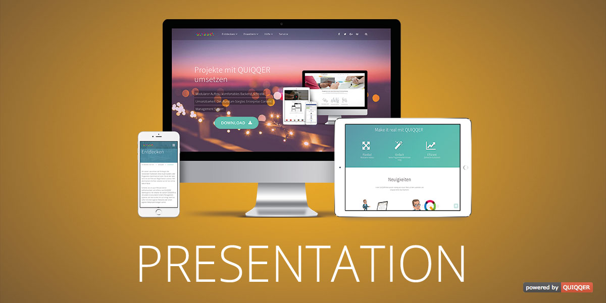

Product Presentation
========

Business and marketing template for promoting your company or product online.


Package name:

    quiqqer/template-presentation


Features
--------

- Smooth scroll by clicking on every element with #target href attribute (you can disable it by setting `data-qui-disableTemplateScroll="1"`)
- Responsive
- Integrated QUIQQER breadcrumb
- Page transition effects
- Search icon / input in the top navigation
- FontAwesome support
- Placeholder for your socials in the navigation and footer
    - Facebook
    - Twitter
    - Google Plus
    - YouTube
    - GitHub
    - GitLab
- Color management with project palette references and light/dark color pairs
- Light, dark and system appearance; system follows the device setting
- Optional appearance switch for visitors
    - Navigation: icon button or dropdown, separately for desktop and mobile
    - Footer: icon bar, icon button or dropdown
    - The choice is remembered per project and applies to all languages
- Header settings
- Each site can define if header, title and short description should be displayed (override the global setting)
- Template settings cache
- Extra layout to place the bricks on the top (for start page)


Installation
------------

The package name is: quiqqer/template-presentation


Contribute
----------

- Issue Tracker: https://dev.quiqqer.com/quiqqer/template-presentation/issues
- Source Code: https://dev.quiqqer.com/quiqqer/template-presentation


Support
-------

If you have found a bug or want to make improvements,
then you can write an e-mail to support@pcsg.de.


License
-------

PCSG QL-1.0, CC BY-NC-SA 4.0

Appearance switch icons: [Lucide](https://lucide.dev) (ISC, partly MIT),
see `template/colorModeSwitch/LICENSE-lucide.txt`.

Developer
---------

**Template events**  
Extend the HTML head, page content, header and footer through template events.
See the [Template Events wiki page](https://dev.quiqqer.com/quiqqer/template-presentation/-/wikis/Template-Events)
for all available hooks, their positions and conditions, and an `events.xml` / PHP example.

**Smooth scroll to an element**  
Smooth scroll by clicking on every `<a>` element with `href="#target"` attribute. 
You can disable it by setting `data-qui` attribute.

```html
<!-- smooth scroll on -->
<a href="www.example.com/subpage#myTarget">
  Scroll to "myTarget" element
</a>

<!-- smooth scroll off -->
<a href="www.example.com/subpage#myTarget" data-qui-disableTemplateScroll="1">
  Directly "jump" to "myTarget" element
</a>
```


**Smooth scroll on page load**  
By using `#anchor` in the url the browser jumps immediately to the desired element when
the page is loaded. You can use `#go_` anchor to auto smooth scroll to this element.

```html
<!-- standard browser behavior --> 
<a href="www.example.com/subpage#myTarget">
  Go to the address and jump to the target element
</a>

<!-- smooth scroll on page load -->
<a href="www.example.com/subpage#go_myTarget">
  Go to the address and scroll to the target element
</a>
```

**Appearance (light, dark, system)**  
The current selection is available as `data-presentation-mode` (`system`, `light`
or `dark`) on the `<html>` element. Colors use `light-dark()`, so a browser with
`color-scheme` and `light-dark()` support is required. Concrete project, page and
brick colors as well as custom CSS are not adapted automatically, and images or
logos are never inverted. After upgrading to v7, review custom colors, images and
bricks, or set the default appearance to *Light* until the site is ready.

**Appearance switch**  
Include the switch in template code where you need it. Render it only when
visitors may change the appearance:

```smarty
{assign var=colorMode value=$Template->getAttribute('TemplateSetting')->getAttribute('colorMode')}
{if $colorMode.allowVisitor}
    {fetch template="template/colorModeSwitch.html" view="dropdown" mode=$colorMode.defaultMode}
{/if}
```

Available views: `compact`, `icons`, `choice` (icons with labels) and `dropdown`.
All instances on a page stay in sync. The dropdown uses `popover` and CSS anchor
positioning; its JavaScript fallback is marked with
`@todo ANCHOR-POSITIONING-FALLBACK` and can be removed once anchor positioning is
widely supported.
